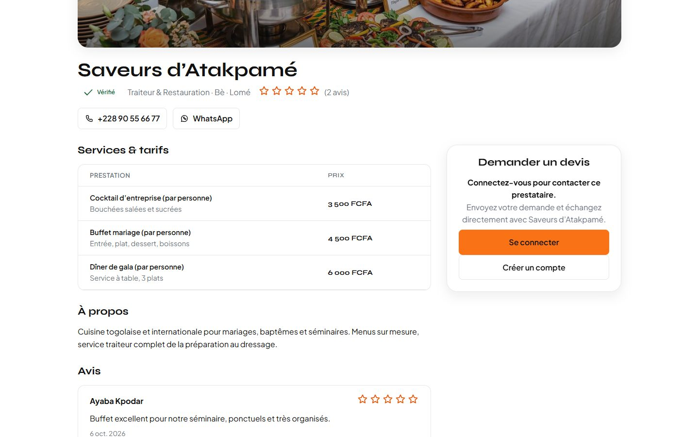
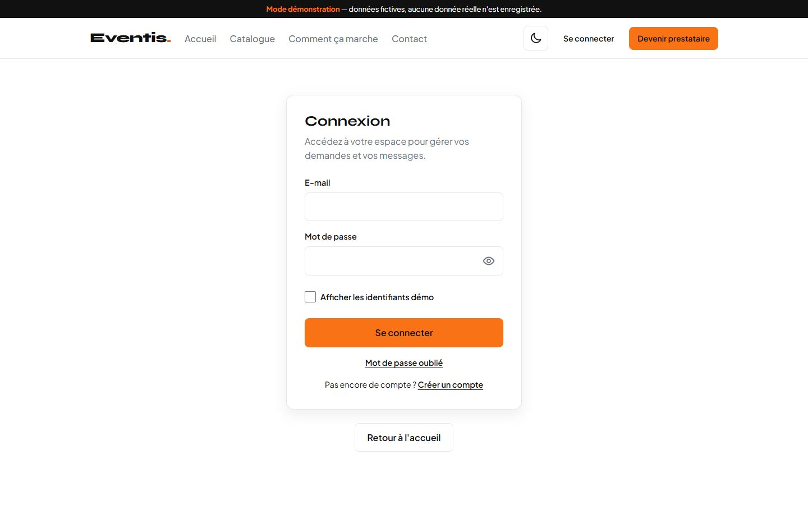
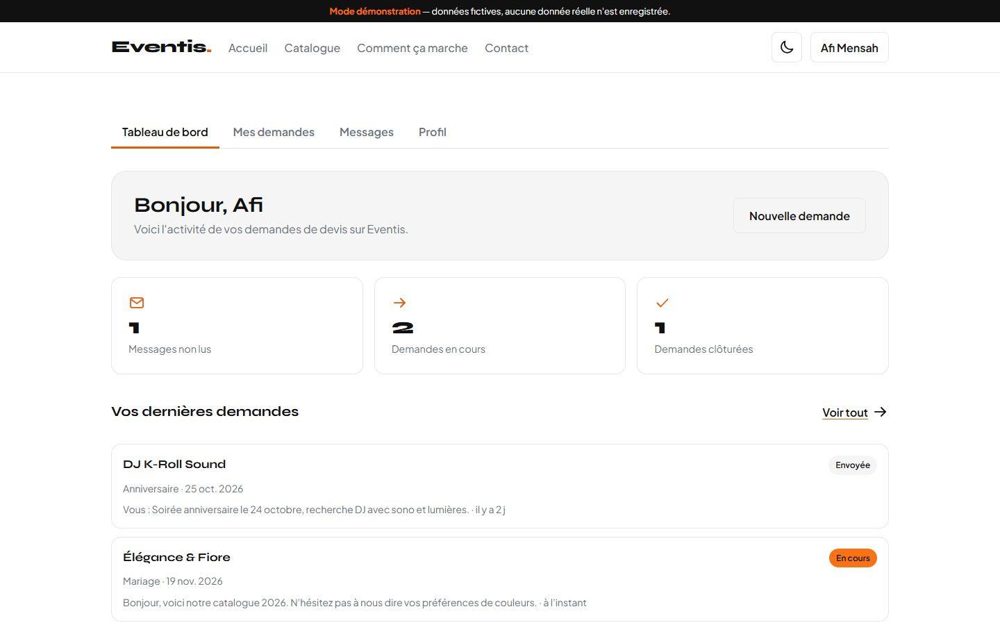
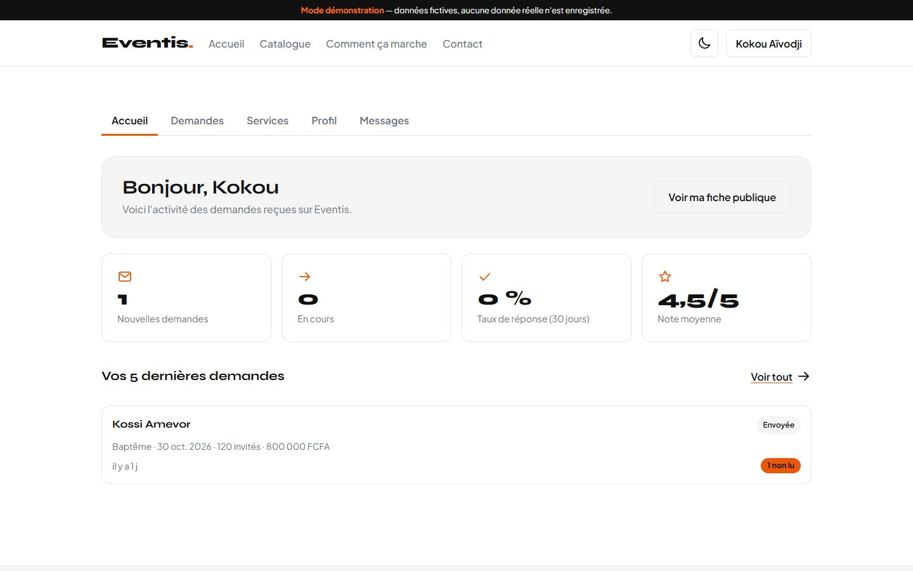
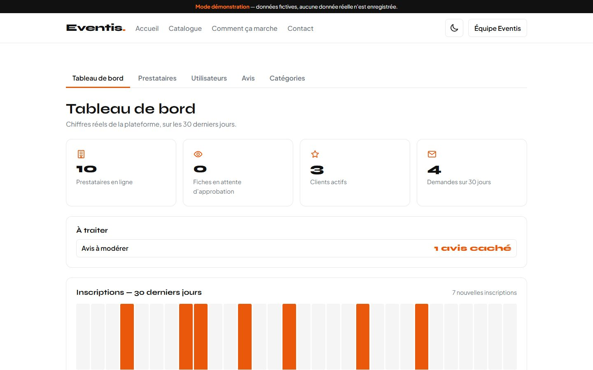

# Eventis

**L'excellence événementielle, connectée et sécurisée.**

Plateforme de mise en relation entre clients et prestataires événementiels — traiteurs, salles,
photographes, sonorisation, décoration — conçue pour le **Togo** (Lomé) et l'Afrique de l'Ouest.
Prix en **FCFA**, interface intégralement en **français**, pensée pour rester utilisable sur des
**connexions lentes**.


> **Principe directeur du projet :** aucune fonctionnalité n'est présentée comme opérationnelle
> si elle ne l'est pas réellement. Le badge vert « Vérifié » vient d'une décision prise dans
> l'espace d'administration — pas d'un champ de démonstration, et pas d'une promesse.

---

## 1. Le problème

Organiser un mariage, un baptême ou un événement d'entreprise à Lomé repose aujourd'hui sur le
bouche-à-oreille, les statuts WhatsApp et les groupes Facebook. Conséquences concrètes :

- **côté client** — impossible de comparer les prestataires sur des critères fiables (tarifs
  réels, disponibilité, prestations passées) ; le « vérifié » n'existe nulle part, et chaque
  devis s'improvise par téléphone ;
- **côté prestataire** — aucune vitrine structurée : les tarifs et les prestations vivent dans
  des albums photo et des messages, et la prospection dépend de la chance ;
- **pour les deux** — la négociation se dilue dans une messagerie non organisée, sans
  historiquement de trace par dossier, et sans aucun mécanisme de confiance.

## 2. L'objectif

Eventis est un **annuaire qualifié + un espace de travail partagé** : on y trouve un prestataire
fiable, on lui demande un devis, on échange dans le fil de la demande, on évalue la prestation
réalisée — et l'équipe Eventis tranche sur ce qui est publié et sur ce qui est vérifié.

**Public visé**

| Profil | Ce que la plateforme lui apporte |
|---|---|
| Clients (particuliers, entreprises, diaspora) | catalogue filtrable, fiches détaillées avec tarifs en FCFA, demande de devis en 1 écran, suivi et messagerie |
| Prestataires événementiels | vitrine maîtrisée (services, tarifs, galerie), réception et qualification des demandes, gestion de leur offre |
| Équipe Eventis (rôle administrateur) | modération des fiches, attribution du badge « Vérifié », modération des avis, catégories, statistiques d'activité |

**Valeur ajoutée** : un socle de confiance explicite (modération humaine + avis publiés uniquement
après prestation clôturée), une expérience légère et rapide (aucun framework, aucun build,
polices et bibliothèques servies en local), et un produit pensé dès la conception pour le marché
togolais : FCFA, français, mobile-first, fonctionne hors ligne une fois visité.

## 3. Aperçu

| Accueil | Catalogue |
|---|---|
|  |  |

| Fiche prestataire | Connexion |
|---|---|
|  |  |

| Tableau de bord client | Espace prestataire |
|---|---|
|  |  |

| Administration | Mobile (390 px) |
|---|---|
|  |  |

*Ces captures ont été prises sur l'application réellement en cours d'exécution, en mode
démonstration, dans Chrome à 1440 × 900 et 390 × 844. Les visuels des prestataires sont des
images de démonstration générées, et non des prestations réelles.*

## 4. Fonctionnalités

Légende : ✅ implémenté et vérifié par exécution · ⚙️ présent mais dépend d'une configuration
externe · ⛔ hors périmètre de la phase 1.

### Parcours visiteur

| Fonctionnalité | État | Détail |
|---|---|---|
| Catalogue | ✅ | recherche, filtres catégorie / quartier / budget / note / « vérifié », tris, 10 prestataires de démonstration |
| Fiche prestataire | ✅ | galerie, services et tarifs en FCFA, avis publiés, coordonnées, demande de devis intégrée |
| Pages d'information | ✅ | « Comment ça marche », contact, mentions légales, page 404 réelle (vrai statut HTTP au développement) |

### Comptes et rôles

| Fonctionnalité | État | Détail |
|---|---|---|
| Inscription / connexion / déconnexion | ✅ | trois rôles : client, prestataire, administrateur ; redirection vers l'espace du rôle |
| Connexion « Continuer avec Google » | ⚙️ | bouton sur connexion et inscription, retour OAuth avec **choix du rôle confirmé par l'utilisateur** (client ou prestataire, jamais administrateur) ; code en place et simulé, **jamais exercé contre le vrai fournisseur Google** (voir §7bis) |
| Gardes de session | ✅ | les 14 pages protégées redirigent sans session ; un client appelé sur `/admin/` revient sur son espace |
| Mot de passe oublié | ⚙️ | mode démo : **aucun e-mail n'est envoyé**, la page le dit. Mode réel : e-mail envoyé par Supabase, puis page [`auth/reinitialisation.html`](auth/reinitialisation.html) qui **ne propose le formulaire que si elle est atteinte par le lien** (sinon elle explique « lien manquant » ou « lien expiré ») ; son URL doit figurer dans les *Redirect URLs* du projet (§7bis) |

### Espace client

| Fonctionnalité | État | Détail |
|---|---|---|
| Tableau de bord | ✅ | messages non lus, demandes en cours / clôturées, derniers dossiers |
| Demandes de devis | ✅ | envoi depuis une fiche (date passée refusée), statut envoyé → en cours → clôturé |
| Messagerie | ✅ | un fil par demande, aller-retour, accusés de lecture ; **pas de temps réel** : rechargement à la demande |
| Avis | ✅ | dépôt possible uniquement après clôture de la prestation, en attente de modération |

### Espace prestataire

| Fonctionnalité | État | Détail |
|---|---|---|
| Demandes reçues | ✅ | accepter, refuser, clôturer |
| Services et tarifs | ✅ | création, modification, suppression des lignes d'offre |
| Profil public | ✅ | édition des informations de la fiche ; **le statut d'approbation et le badge « Vérifié » ne sont pas modifiables par le prestataire** |
| Messagerie | ✅ | même module que l'espace client, côté prestataire |

### Administration

| Fonctionnalité | État | Détail |
|---|---|---|
| Statistiques | ✅ | prestataires en ligne, fiches en attente, clients actifs, demandes sur 30 jours, graphique des inscriptions |
| Modération des prestataires | ✅ | approbation, suspension (la fiche sort du catalogue public et devient non réservable), badge « Vérifié » |
| Comptes utilisateurs | ✅ | consultation, suspension et réactivation ; un compte suspendu ne peut plus se connecter |
| Modération des avis | ✅ | file d'attente, publication, masquage ; l'avis publié apparaît sur la fiche publique |
| Catégories | ✅ | création (slug automatique), renommage, activation / désactivation ; repercute sur les filtres du catalogue |
| Mode maintenance | ⚙️ | interrupteur « Activé / Désactivé » + message facultatif, enregistrés dans Supabase (`site_settings`) ; la page [`maintenance.html`](maintenance.html) et la edge function [`netlify/edge-functions/maintenance.js`](netlify/edge-functions/maintenance.js) sont écrites et éprouvées en local, **le blocage réel des pages publiques n'est mesurable qu'après déploiement** (§9) |
| Messages du formulaire de contact | ⚙️ | enregistrés (`contact_messages` en mode réel) mais **aucun écran d'administration ne les consulte encore** : en mode réel, la lecture se fait depuis la console Supabase |

### Transverse

| Fonctionnalité | État | Détail |
|---|---|---|
| Mode démonstration | ✅ | tout est stocké dans le navigateur (`localStorage`) : aucun serveur, aucune base ; bannière permanente rappelant le caractère fictif des données |
| Connecteur Supabase | ⚙️ | authentification + PostgreSQL + règles RLS ; **interchangeable avec le mode démo sans toucher au code des pages**, mais jamais exercé contre une instance réelle (voir §8 et §10) |
| Responsive | ✅ | mobile-first, contrôlé de 360 à 1440 px |
| PWA | ✅ | manifeste, icônes, service worker hors ligne (réseau d'abord pour les pages, cache d'abord + révalidation pour les ressources) |
| Mode sombre · animations | ✅ | thème clair/sombre avec contrastes mesurés, animations GSAP neutralisées sous `prefers-reduced-motion` |
| Accessibilité | ✅ | lien d'évitement, focus toujours visible, navigation clavier, modales `role="dialog"` + Échap, échappement HTML systématique |
| Paiement, réservation, contrat en ligne | ⛔ | **absent du périmètre** : aucun moyen de paiement n'est intégré ; la mise en relation s'arrête au devis et à la messagerie |

## 5. Technologies

Ce qui est réellement dans le dépôt — pas de liste théorique :

- **HTML5** — 28 pages, multi-pages réel (pas de routeur, pas de SPA).
- **CSS3** natif — 13 feuilles : tokens de thème (`--accent`, `--surface`, thème sombre par
  `data-theme`), `grid`, `clamp()`, requêtes de médias. **Aucun framework CSS, aucune classe
  utilitaire générée** (vérifié : zéro occurrence de Bootstrap dans le dépôt).
- **JavaScript ES modules natif** — 42 modules, `import`/`export`, top-level `await`. Aucun
  bundler, aucune étape de compilation, `package.json` ne déclare aucune dépendance.
- **Supabase** — client `supabase-js` servi en local (`assets/vendor/`), adaptateur de données
  et authentification dans [assets/js/core/](assets/js/core/).
- **GSAP + ScrollTrigger** — animations d'apparition, pilotées depuis
  [assets/js/core/ui.js:141](assets/js/core/ui.js#L141), désactivées si le mouvement réduit est demandé.
- **PWA / Service Worker** — [manifest.webmanifest](manifest.webmanifest), [sw.js](sw.js),
  icônes 192 / 512 / SVG.
- **Polices auto-hébergées** — Syne (titres) et Plus Jakarta Sans (interface) en `woff2` local,
  pour éviter une requête vers un CDN sur les connexions lentes.
- **Node.js (outillage)** — serveur de développement sans dépendance
  ([tools/serve.js](tools/serve.js)), générateur de seed ([tools/export-seed.mjs](tools/export-seed.mjs)),
  exécution des tests avec le `node:test` natif.
- **Git / GitHub** — historique de 43 commits sur la branche `main`.

**En chiffres :** ~8 600 lignes de HTML/CSS/JS écrits à la main (hors bibliothèques
`assets/vendor/`, hors tests et outillage), 28 pages, 3 rôles, 4 fichiers SQL.

## 6. Installation locale

### Prérequis

**Node.js 18 ou plus récent.** C'est tout : aucune installation de dépendance (`npm install` est
inutile — le `package.json` ne déclare aucun paquet), aucun build, aucun framework.

### Lancer l'application

```bash
git clone https://github.com/arthurdevcod02/eventis.git
cd eventis

node tools/serve.js              # → http://localhost:4173
PORT=8080 node tools/serve.js    # autre port
```

Ouvrir **http://localhost:4173**. Arrêter le serveur avec `Ctrl+C`.

### Comptes de démonstration

Mot de passe commun : `demo1234` (la page de connexion propose une case « Afficher les
identifiants démo » qui remplit ces comptes en un clic).

| Rôle | E-mail |
|---|---|
| Client | `client@demo.tg` |
| Prestataire | `prestataire@demo.tg` |
| Administrateur | `admin@demo.tg` |

Le jeu de démonstration contient 10 prestataires de Lomé, leurs services, des demandes, des
messages et des avis — dont un avis en attente de modération, pour montrer la file administrative.
**Toutes les données sont fictives** : e-mails en `@demo.tg` / `@example.tg`, téléphones
normalisés non attribués, photos générées.

Ces trois identifiants ouvrent une session **en mode démonstration** (données du navigateur). Sur un
projet Supabase où la purge du §7 a été jouée, ils n'existent plus et la page de connexion renvoie
l'erreur d'authentification — c'est le but : ces mots de passe sont publics dans ce dépôt.

### Exécuter les tests

```bash
node --test "tests/*.test.js"
```

89 tests natifs, sur sept fichiers : couche de données (mode démo, contrat `site_settings`),
authentification démo et contrat OAuth (`signInWithGoogle`, profil en attente, complément
d'inscription), contrat de garde de session Supabase, helpers de redirection Google, formats
français (`Intl`, FCFA, dates), verrous du mode maintenance, **verrous des en-têtes livrés**
(`tests/headers.test.js` : CSP directive par directive, absence de script inline dans les 28 pages)
et **verrous des fichiers de purge** (`tests/purge.test.js` : ordre imposé par les clés étrangères,
garde-fou d'administrateur, fichier d'état des lieux strictement en lecture, liste des comptes lue à
partir de `seed.sql`). Les sept verrous de purge ont été vérifiés par contrôle négatif : chaque
invariant cassée une à une fait bien tomber le test correspondant.

## 7. Configuration Supabase (mode réel)

**État réel (16 octobre 2026)** : `schema.sql`, `rls.sql`, les correctifs de cloisonnement
(`4add89e`, `e9ed774`) et `maintenance.sql` **ont été joués sur le projet en ligne**, et les
séparations de rôles ont été mesurées depuis le navigateur (un client ne lit pas les fiches
privées d'un prestataire, un prestataire ne se décerne pas le badge, un visiteur non connecté ne
change pas le drapeau de maintenance). `seed.sql` y a aussi été exécuté : **ses comptes de
démonstration sont encore en base** et doivent être purgés avant d'accueillir de vrais clients.
Ce qui reste **non validé** : le consentement Google réel et son retour (§7bis), et les droits des
fonctions SQL `security definer` tels qu'ils existent dans cette instance (à relire dans
Supabase → Authentication → Policies / Database Functions). La purge des comptes de seed et des
sondes de QA, elle, est **écrite et verrouillée par tests mais pas encore jouée** : voir
« Purger une base qui a servi de terrain de jeu » plus bas dans ce paragraphe.

1. Créer un projet sur [supabase.com](https://supabase.com).
2. Dans le **SQL Editor**, exécuter dans cet ordre :
   - [`supabase/schema.sql`](supabase/schema.sql) — tables et contraintes,
   - [`supabase/rls.sql`](supabase/rls.sql) — règles de sécurité au niveau ligne + déclencheurs
     de modération,
   - [`supabase/seed.sql`](supabase/seed.sql) — jeu de démonstration (facultatif).
   - **Sur un projet déjà provisionné**, coller plutôt
     [`supabase/maintenance.sql`](supabase/maintenance.sql) : il crée la table `site_settings`,
     ses politiques RLS et la ligne unique, sans retoucher les objets existants (relancer
     `schema.sql` en entier échoue dès la première table déjà créée). Le fichier est idempotent et
     son `insert … on conflict do nothing` ne remet **jamais** le site en service en cachette.
3. Renseigner dans [`assets/js/core/config.js`](assets/js/core/config.js) :
   `SUPABASE_URL` (URL du projet) et `SUPABASE_ANON_KEY` (**clé anonyme**, jamais la clé `service_role`).
4. Dans **Authentication → Sign In / Providers → Email**, « Confirm email » peut être **activé ou
   désactivé** : les deux parcours sont gérés. Désactivé, l'inscription ouvre une session et écrit
   la ligne `profiles` immédiatement. Activé, aucune session n'existe encore — et la politique RLS
   « profiles self insert » (`id = auth.uid()`) refuse toute écriture : l'application conserve donc
   le nom, le téléphone, le rôle et la version des CGU dans les **métadonnées** du compte, affiche
   « Confirmez votre adresse e-mail », et écrit le profil au retour du lien, sur la page de
   connexion (l'écran de rôle reprend le rôle choisi).
5. **Authentication → URL Configuration** : *Site URL* et *Redirect URLs*, listés au §7bis (ils
   décident où atterrissent le lien de confirmation d'inscription et le lien « Mot de passe oublié »).
6. Recharger la page : la bannière « Mode démonstration » disparaît, les données viennent de
   Supabase. Laisser les deux champs vides ramène au mode démonstration.

**Notes propres à ce projet**

- `seed.sql` crée aussi les lignes `auth.users` correspondantes (mot de passe `demo1234`) : sans
  elles, les `profiles` inserés violent la clé étrangère vers `auth.users` et **tout le script
  échoue**. Ce fichier est généré : `node tools/export-seed.mjs > supabase/seed.sql`.
- **Projet déjà provisionné avant l'ajout de la colonne `email`** : la table `profiles` ne l'a
  pas et l'inscription échoue à l'insertion. Corriger une fois :

  ```sql
  alter table public.profiles add column email text;
  update public.profiles p set email = u.email from auth.users u where p.id = u.id;
  ```

### Purger une base qui a servi de terrain de jeu

`seed.sql` crée de vrais comptes `auth.users` avec le mot de passe `demo1234`, et ce mot de passe
est publié deux fois dans le dépôt (le fichier lui-même et le §6 ci-dessus). Tant que ces lignes
existent sur un projet en ligne, **n'importe qui peut ouvrir une session — y compris
administratrice — sur ton instance**, avec des identifiants que tu as toi même rendus publics. Les
sondes de QA, elles, laissent des comptes, des demandes, des fils de messages et des avis de test
dont personne n'a besoin. Quatre fichiers, à coller un par un dans le **SQL Editor** :

| Fichier | Écrit ? | Ce qu'il fait |
|---|---|---|
| [`supabase/purge-etat-des-lieux.sql`](supabase/purge-etat-des-lieux.sql) | **non** | Qui peut se connecter, à qui appartiennent les fiches, ce que chaque variante emporterait, et le nombre d'administrateurs survivants. À lancer **avant** toute purge. |
| [`supabase/purge-sondes-qa.sql`](supabase/purge-sondes-qa.sql) | oui | Les comptes de test (`qa.eventis.*`, `*.qa@…`, `…@qa.tg`, `qa@demo.tg`) avec leurs demandes, messages, avis, fiches déposées et messages de contact. **Le catalogue de démonstration n'est pas touché.** |
| [`supabase/purge-demo-catalogue-intact.sql`](supabase/purge-demo-catalogue-intact.sql) | oui | Les 14 comptes du seed, **en réattachant** les 10 fiches et les avis à un administrateur qui survit : le site reste peuplé, les connexions de démo disparaissent. |
| [`supabase/purge-demo-catalogue-vide.sql`](supabase/purge-demo-catalogue-vide.sql) | oui | Les 14 comptes **et** tout ce qu'ils portaient (fiches, prestations, avis, demandes, messages). Les 8 catégories restent : c'est une taxonomie, pas un contenu fictif. Choix honnête si le site ne doit rien laisser croire. |

Trois choses sont garanties par construction dans les fichiers qui écrivent, et vérifiées par
`tests/purge.test.js` :

- **un seul bloc `do $$ … end $$`** = une seule instruction = tout ou rien. Si une vérification
  échoue, aucune ligne n'a été touchée ;
- **garde-fou d'administrateur** : si la purge devait retirer le dernier compte `admin`, le fichier
  lève une exception au lieu d'exécuter. Sans lui, `/admin` et la bascule de maintenance
  deviennent inaccessibles, et `admin@demo.tg` est justement dans la liste à supprimer ;
- **ordre dicté par les clés étrangères** : `messages`, `reviews`, `requests`, `providers`,
  `contact_messages`, `profiles`, puis `auth.users` en dernier. Quatre de ces liens n'ont **pas** de
  cascade (`requests.client_id`, `requests.provider_id`, `messages.sender_id`, `reviews.client_id`),
  donc un ordre différent fait échouer la purge en cours de route — ou, pire, emporte des lignes
  voisines par cascade.

Prérequis avant les deux dernières lignes du tableau : un compte administrateur réel.
`update public.profiles set role = 'admin' where email = 'ton@adresse';` après inscription, et
l'état des lieux doit afficher « administrateurs survivants = 1 ».

Après purge, **ne relance jamais `seed.sql`** sur ce projet : il réinsère les 14 comptes et rouvre
exactement le trou qu'on vient de fermer. Le mode démonstration du navigateur
(`assets/js/core/seed.js`) est une autre mécanique, sans aucun compte réel, et n'est pas concerné.

Ces quatre fichiers sont **relus et verrouillés par tests, jamais exécutés** : aucune instance
Postgres n'est accessible depuis la machine de développement, et je n'écris pas dans ta base à ta
place. Le premier se passe de preuve d'exécution (il ne fait que lire) ; pour les trois autres, la
preuve est le `select` final de chaque fichier, qui doit afficher les compteurs attendus.

**Ce qui reste indisponible tant que cette configuration n'est pas faite :** persistance partagée
entre navigateurs, e-mail de réinitialisation de mot de passe, consultation des messages de
contact ailleurs que dans le navigateur qui les a saisis. Pour le mode maintenance, il manque de
plus les deux variables Netlify de l'annexe « mettre en ligne » : sans elles, l'interrupteur enregistre bien le drapeau
mais **aucune page ne se ferme**. Tout le reste fonctionne en démo.

## 7bis. Connexion Google (OAuth) — ce qui est fait, ce qui reste à configurer

**Ce qui est en place dans le code**

- Bouton **« Continuer avec Google »** sur [`auth/connexion.html`](auth/connexion.html) et
  [`auth/inscription.html`](auth/inscription.html), à côté de la connexion e-mail/mot de passe
  (inchangée). La connexion classique reste le chemin principal ; Google s'y ajoute.
- [`assets/js/core/oauth.js`](assets/js/core/oauth.js) porte les helpers sans DOM : URL de retour
  calculée depuis `location.origin` (la même ligne fonctionne en local et en production, sans
  constante d'environnement), contrôle anti-redirection ouverte (`safeNext` : chemins internes
  uniquement), intention de retour conservée en `sessionStorage`, et messages d'erreur français
  pour les pannes réellement observables (fournisseur non activé, URL de retour refusée, Supabase
  injoignable).
- Le rôle **n'est jamais attribué automatiquement** : au retour de Google, si aucune ligne
  `profiles` n'existe pour la session, la page d'authentification ouvre un écran « Je viens… »
  qui propose **client** ou **prestataire** et attend une confirmation explicite. Un compte Google
  ne peut pas devenir administrateur par ce chemin — la liste des rôles proposés l'exclut,
  `completeSignup()` le refuse, et côté base la politique RLS d'auto-insertion (`role <> 'admin'`)
  plus le déclencheur `guard_profile_privileges` réécrivent toute tentative.
- En **mode démonstration**, le bouton reste visible et un clic affiche ce message, sans
  simulation de session : « Connexion Google indisponible en mode démonstration : elle exige un
  projet Supabase avec le fournisseur Google activé. Utilisez les comptes de démonstration. »

**Ce qui n'est PAS encore opérationnel**

Le trajet réseau Google (consentement, échange du code, retour réel) **n'a jamais été exercé** :
il exige un projet Supabase et un client OAuth Google, deux choses qui n'existent pas encore.
Aucune donnée de session Google n'a été fabriquée pour faire croire au contraire.

**Configuration à réaliser (dans cet ordre)**

1. [Google Cloud Console](https://console.cloud.google.com) → *APIs & Services → Credentials* →
   **Create Credentials → OAuth client ID**, type *Web application*.
   - *Authorized JavaScript origins* : `http://localhost:4173` et l'URL du site en production.
   - *Authorized redirect URIs* : `https://<projet>.supabase.co/auth/v1/callback` (l'URL exacte est
     donnée par Supabase à l'étape 3).
   - Noter le **Client ID** et le **Client secret**.
2. Supabase → **Authentication → URL Configuration** :
   - *Site URL* : `https://<domaine>` (production),
   - *Redirect URLs* : les quatre retours attendus par l'application, chacun en local **et** en
     production —
     `http://localhost:4173/auth/connexion.html` et `https://<domaine>/auth/connexion.html`
     (retour Google et retour du lien de confirmation d'inscription),
     `http://localhost:4173/auth/reinitialisation.html` et
     `https://<domaine>/auth/reinitialisation.html` (lien « Mot de passe oublié »).
     Une `redirectTo` absente de cette liste est **silencieusement remplacée** par le *Site URL* :
     le lien tombe alors sur l'accueil au lieu du formulaire attendu.
3. Supabase → **Authentication → Sign In / Providers → Google** : activer le fournisseur et coller
   le Client ID / Client secret de l'étape 1.
4. Revenir sur la page de connexion et cliquer « Continuer avec Google » : le consentement
   s'ouvre, le retour ramène sur `connexion.html`, l'écran de rôle demande client ou prestataire.
   Le premier essai réel est le test qui manque.

**Rappels utiles**

- « Confirm email » ne bloque plus l'inscription (voir §7, point 4) : le compte connecté sans ligne
  `profiles` est exactement l'état que l'écran de rôle sait compléter, qu'il arrive de Google ou du
  lien de confirmation.
- Le nom affiché sur cet écran vient des métadonnées du fournisseur (`user_metadata.full_name`,
  sinon `name`, sinon la partie locale de l'adresse e-mail).
- Un compte Google suspendu par un administrateur est déconnecté dès la tentative d'accès.

## 8. Sécurité

**Ce qui est en place dans le code**

- **Clé anonyme uniquement.** [`assets/js/core/config.js`](assets/js/core/config.js) ne contient
  que des chaînes vides dans le dépôt ; la clé `service_role` ne doit **jamais** y figurer. La
  protection des données vient des règles RLS, pas du secret de la clé.
- **Règles RLS** ([`supabase/rls.sql`](supabase/rls.sql)) : lecture publique restreinte aux
  prestataires approuvés, écritures réservées au propriétaire de la fiche ou de la demande,
  avis insérables uniquement par le client concerné, modération réservée aux administrateurs.
- **Deux déclencheurs de modération**, parce qu'une politique RLS ne peut pas comparer l'ancienne
  et la nouvelle valeur d'une ligne : `providers.status`, `providers.is_verified`,
  `profiles.role` et `profiles.suspended` sont remis à leur valeur précédente si l'auteur de la
  requête n'est pas administrateur. Un prestataire ne peut donc pas approuver sa propre fiche ni
  se décerner le badge « Vérifié » ; un compte ne peut pas se promouvoir admin ni lever sa propre
  suspension.
- **Le drapeau de maintenance se lit publiquement et ne s'écrit que par un admin.** La table
  `site_settings` a une politique de lecture `using (true)` — la edge function l'appelle avec la
  seule clé `anon`, sans jamais demander la clé `service_role` — et trois politiques d'écriture
  `to authenticated using/with check (is_admin())`. Sans session, `auth.uid()` est nul : un
  visiteur non connecté ne peut ni activer ni désactiver la maintenance, même en fabriquant la
  requête à la main.
- **Ce que le filtre de maintenance ne peut pas savoir.** La session d'Eventis vit dans le
  `localStorage` du navigateur, jamais dans un cookie : Netlify ne reçoit donc aucun identifiant
  avec la demande et ne peut pas distinguer un administrateur d'un visiteur. Choix assumé :
  `/admin/` et `/auth/` ne sont pas filtrés, pour qu'un administrateur puisse toujours revenir
  couper la maintenance — même déconnecté. Les données derrière ces pages restent verrouillées
  par le RLS ; seule la coquille HTML se charge.
- **Identité d'expéditeur contrôlée** : un message ne peut être inséré qu'avec
  `sender_id = auth.uid()`, donc pas d'usurpation dans le fil d'un autre participant.
- **Échappement HTML systématique** (`esc()` dans `ui.js`) : une charge utile
  `` saisie dans un formulaire reste du texte affiché, jamais exécuté
  (contrôlé côté inscription, profil et tableau admin).
- **Content-Security-Policy en service** ([`netlify.toml`](netlify.toml)) : `script-src 'self'`,
  **sans** `'unsafe-inline'` ni `'unsafe-eval'`. Le site n'a que des scripts du dépôt, donc un
  script injecté par une faille XSS ne s'exécute plus — c'est la seconde porte derrière `esc()`.
  Le bootstrap de thème, seul `<script>` inline des 28 pages, est devenu
  [`assets/js/theme-bootstrap.js`](assets/js/theme-bootstrap.js) pour rendre ce réglage possible ;
  `tests/headers.test.js` empêche qu'un `<script>` inline ou un `onclick=` revienne dans une page.
  Avec : `connect-src 'self' https://*.supabase.co` (le site ne parle qu'à Netlify et Supabase),
  `object-src 'none'`, `base-uri 'self'`, `form-action 'self'`, `frame-ancestors 'none'`,
  `X-Frame-Options: DENY` (clickjacking), `Referrer-Policy: strict-origin-when-cross-origin`
  (un retour OAuth ou un jeton de réinitialisation ne part pas chez un tiers),
  `Permissions-Policy` refusant caméra, micro, géolocalisation, paiement et partage d'écran.
  Seul relâchement : `style-src … 'unsafe-inline'`, parce que le graphique de l'admin et les
  squelettes du catalogue dimensionnent des blocs par attribut `style="…"` ; un style ne peut pas
  exécuter de code.
  **Mesuré**, sur `dist/` servi par un serveur qui rejoue ces en-têtes (un serveur local muet ne
  prouverait rien) : 29 URL dans les quatre espaces, zéro violation ; un `fetch` vers
  `example.com` est refusé par `connect-src` ; un `<script>` ajouté en console ne s'exécute pas
  (`window.__pvu` reste `undefined`) ; l'appel réel à Supabase passe (200) ; et le clic « Connexion
  avec Google » décolle toujours vers `accounts.google.com`.
- **Le badge « Powered by Netlify » est bloqué par la CSP, et c'est voulu.** Netlify injecte lui-même
  sur chaque page produite un `<script async src="/.netlify/scripts/hud">` (repéré en production, pas
  deviné : la liste des scripts d'une page en ligne ne contient que nos fichiers, plus celui-là). Ce
  script construit un `iframe` en `srcdoc`, donc exécute du code inline. Sous `script-src 'self'`, la
  violation est bloquée et le badge ne s'affiche pas — la page, elle, se charge et fonctionne
  intégralement (mesuré : 15 URL en production, aucune erreur d'affichage, images et navigation
  correctes, catalogue peuplé). La documentation de l'hébergeur est explicite : autoriser le badge
  exige `'unsafe-inline'` dans `script-src`, et il n'existe ni nonce ni hash prévu pour lui.
  **Arbitrage rendu : on ne rouvre pas `script-src` pour un badge.** Un `unsafe-inline` autorisé pour
  le badge l'est aussi pour tout script qu'une faille XSS injecterait — c'est exactement la porte que
  cette CSP ferme. La sortie propre est du côté de l'hébergeur, en un clic et sans redéploiement :
  **Netlify → Project configuration → General → « Powered by Netlify badge » → off**. Tant que
  ce réglage n'a pas été fait, chaque page en ligne écrit une violation CSP dans la console du
  navigateur — sans effet visible, mais comptabilisée (voir §9).
- **Service worker strict** : uniquement les `GET` de la même origine, aucune mise en cache des
  URLs paramétrées, `sw.js` jamais caché, et les appels vers `*.supabase.co` explicitement exclus.
- **`config.js` n'attend pas la prochaine visite.** Le cache-d'abord est juste pour les ressources
  inoffensives ; `config.js` porte l'URL et la clé du projet Supabase, donc décide du mode démo ou
  réel. Une version périmée y ferait rester un visiteur connu toute une visite de trop. Le fichier
  est passé en réseau d'abord (`NETWORK_FIRST` dans `sw.js`), avec repli sur le cache quand le
  réseau est réellement absent. Mesuré dans un navigateur : après deux changements côté serveur,
  `config.js` renvoie à chaque fois la valeur neuve (`B`, puis `C`) alors que `tokens.css`, témoin
  cache-d'abord, renvoie toujours l'ancienne ; serveur éteint, `config.js` répond encore depuis le cache.
- **La déconnexion vide l'écran.** `signOut()` seul ne quittait pas la page : `requireAuth` ne joue
  qu'au chargement, donc les demandes, messages et fiches de l'espace quitté restaient affichés
  après la déconnexion. Le bouton « Déconnexion » mène maintenant à l'accueil (`signOutTarget()`
  dans `guards.js`) — jamais à l'espace d'un rôle, la session vient de disparaître, et jamais à
  `connexion.html`, qui présupposerait une envie de se reconnecter. `location.replace` empêche la
  page protégée de rester dans l'historique à cette position ; le retour arrière d'un visiteur
  déconnecté retombe sur la page de connexion (vérifié dans un navigateur).

**Ce qui n'est pas prouvé — à vérifier avant toute mise en production**

- Le parcours complet en mode réel n'a pas été rejoué page à page depuis un navigateur : inscription
  réelle, session qui expire pendant une visite, accusés de lecture et modération n'ont été mesurés
  que là où les tests de cloisonnement les croisent (§7).
- **Un audit de sécurité indépendant** : la relecture, les verrous de tests et les mesures ci-dessus
  ne remplacent pas un pentest.
- **HSTS** (`Strict-Transport-Security`) : cette ligne n'est plus une inconnue, elle est mesurée en
  production (§9) — `max-age=31536000; includeSubDomains; preload`, sans réglage de ma part. Ce que
  je ne peux pas établir : si cette valeur vient de l'interface de ton compte ou du comportement par
  défaut de l'hébergeur. Le jeton `preload` n'a d'effet que si le nom de domaine est inscrit sur la
  liste HSTS ; sur un sous-domaine `netlify.app`, il est inoffensif, et il faudra le réévaluer le
  jour d'un domaine perso.
- **La page de maintenance servie en 503 portera-t-elle la CSP ?** `netlify.toml` pose ses
  en-têtes sur les fichiers, pas sur une réponse fabriquée par une fonction : la edge function
  relit donc ceux de `/maintenance.html` avant de renvoyer son 503. Ce report est écrit, testé en
  texte, mais **jamais mesuré en ligne** — il faut pour cela actionner l'interrupteur admin, ce
  qui n'a pas encore été fait.
- Le formulaire de contact n'a pas de limite de débit côté serveur (pas de backend applicatif :
  le message est écrit en base sous une politique d'insertion authentifiée ; l'abus vient d'un
  compte légitime, pas d'une requête anonyme).
- Le trajet OAuth Google de bout en bout (consentement réel, échange du code, retour sur
  `connexion.html`) : le départ est maintenant mesuré en navigateur jusqu'à la page de compte
  Google, mais **le retour n'a jamais été parcouru** (il faut un vrai compte Google pour valider
  les identifiants et le jeton). Le reste du câblage applicatif est éprouvé par simulation avec un
  faux client (§7bis). L'interdiction faite à un compte Google de devenir administrateur repose
  sur trois garde-fous (liste de rôles côté application, politique RLS d'auto-insertion,
  déclencheur `guard_profile_privileges`), dont les deux derniers restent à valider sur une
  instance réelle.

## 9. Tests et état du projet

Phase 1 terminée, fusionnée dans `main`. Résultats ci-dessous **réellement obtenus par exécution**
le 15 octobre 2026, sur le code de la branche `main` :

| Campagne | Portée | Résultat |
|---|---|---|
| `node --test "tests/*.test.js"` | couche de données, authentification démo et contrat OAuth, gardes, formats `Intl` | **48 / 48** |
| QA écran headless | 23 pages : statuts HTTP, erreurs console, requêtes hors origine, débordements de 360 à 1440 px, clavier Tab/Échap, focus visibles, lien d'évitement, modales, échappement XSS, gardes de session, hors ligne, `config.js` vide, mouvement réduit | **47 / 47** |
| QA parcours d'écriture | inscription + validation de formulaires, persistance du profil, envoi de devis (date passée refusée), acceptation prestataire, messagerie aller-retour et accusés de lecture, clôture, avis → modération → publication → affichage public, badge « Vérifié », suspension prestataire et utilisateur, catégories, formulaire de contact, cloisonnement des rôles | **42 / 42** |
| QA Google (mode démonstration) | bouton présent sur les deux pages, message honnête au clic, aucune session fabriquée, connexion e-mail toujours fonctionnelle, mise en page et contrastes mesurés à 6 largeurs | **21 / 21** |
| QA Google (retour simulé, mode réel) | faux client Supabase injecté côté navigateur : session sans profil → écran de rôle, nom repris des métadonnées, aucune écriture avant confirmation, confirmation client (1 ligne `profiles`) et prestataire (`profiles` + `providers`), `?next` retrouvé, intention nettoyée, « Utiliser un autre compte », absence d'intention = page inchangée, clic Google → consentement avec `redirectTo` et `skipBrowserRedirect` | **24 / 24** |
| Contrôle du menu compte | ouvert/fermé, Échap, clic extérieur, 4 pages | **9 / 9** |
| Erreurs JavaScript | cumulé sur les campagnes ci-dessus | **0** |

La campagne « retour simulé » éprouve le **câblage de la page** (détection, écran de rôle,
écritures demandées, redirection) avec un faux client : elle ne prouve **pas** le trajet réseau
Google, qui demande un vrai fournisseur configuré (§7bis).

Trois défauts trouvés pendant cette phase de publication et corrigés depuis (`b5592bc`,
`232d13a`, `30c965c`) : un débordement horizontal de 2 px à 360 px sur la fiche prestataire
connectée, un menu du compte qui restait affiché en permanence (`display: grid` neutralisait
l'attribut `hidden`), et l'impossibilité de le refermer au clavier. Les trois campagnes ont été
rejouées après correction.

**Mode maintenance — campagne du 16 octobre 2026**

| Campagne | Portée | Résultat |
|---|---|---|
| `node --test` (5 fichiers) | contrat `getSiteSettings` / `saveSiteSettings` sur l'adaptateur démo : défauts, élagage du message, relecture par un second adaptateur, stockage antérieur à la table | **76 / 76** |
| Verrous statiques (`tests/maintenance.test.js`) | les trois écritures de `site_settings` bornées `to authenticated` + `is_admin()` dans `rls.sql` **et** `maintenance.sql`, lecture publique conservée, drapeau booléen + ligne unique + plafond de 500, `excludedPath` de la edge function, texte du brief sur la page et absence de date de retour inventée | **5 / 5** |
| QA écran headless | onglet « Paramètres du site » : 6 onglets, état écrit Activé/Désactivé synchronisé sur l'interrupteur, badge « non enregistré », modale de confirmation à l'activation, toast, horodatage, persistance après rechargement ; page de maintenance : message personnalisé repris de l'enregistrement, note de mode démonstration, bouton Réessayer, 1280 et 390 px, thèmes clair et sombre, débordement horizontal | **25 / 25**, 0 erreur console |

**Ce que cette campagne ne prouve pas** : le blocage lui-même. La edge function s'exécute sur
Netlify, avec les variables d'environnement du site ; `tools/serve.js` ne la joue pas et le mode
démonstration n'écrit que dans le navigateur. Les scénarios « un visiteur non connecté reçoit la
page de maintenance » et « une requête directe non autorisée ne peut pas changer le drapeau » sont
à mesurer en ligne, après le `git push` et l'application de `supabase/maintenance.sql` (§7 et annexe
Netlify). Tant que cette mesure n'a pas eu lieu, le mode maintenance est **écrit, pas encore vérifié
en production**.

**En-têtes de sécurité — campagne du 16 octobre 2026**

| Campagne | Portée | Résultat |
|---|---|---|
| `node --test` (6 fichiers, dont `tests/headers.test.js`) | CSP lue dans `netlify.toml` et directive par directive ; aucun `<script>` inline ni `onclick=` dans les 28 pages ; bootstrap de thème chargé sans `defer` avant `<body>` ; en-têtes `X-Frame-Options` / `Referrer-Policy` / `Permissions-Policy` / `nosniff` ; exemptions `/admin` et `/auth` sans barre finale dans la edge function ; report des en-têtes sur la réponse 503 | **82 / 82** |
| Balayage en navigateur, **avec les en-têtes réellement posés** (`dist/` servi par un replay de `netlify.toml`, sessions admin, client et prestataire) | 29 URL : accueil, catalogue, fiche prestataire, contact, 404, maintenance, mentions, CGU, confidentialité, comment-ça-marche, 3 pages d'authentification, 6 pages admin, 4 pages client, 5 pages prestataire | **0 violation CSP, 0 erreur console, 0 image cassée** |
| Contrôle négatif (la CSP tient-elle, ou seulement s'affiche-t-elle ?) | `fetch` vers `example.com` → refusé par `connect-src` (`TypeError`, message de violation dans la console) ; `<script>` ajouté par du code → **non exécuté** (`window.__pvu` reste `undefined`) ; appel réel à `hzhoddyrakfwpucyrcig.supabase.co` → 200 et drapeau lu | **3 / 3** |
| Thème et rendu sous CSP | thème sombre relancé depuis `localStorage` (`dataset.theme = "dark"`, fond `rgb(17,17,17)`) ; 7 barres du graphique admin dimensionnées par attribut `style` (échantillon 160 px) | **OK** |
| Départ OAuth | clic « Connexion avec Google » en mode réel → navigation jusqu'à `accounts.google.com/v3/signin` avec le `redirect_uri` du site | **OK** (retour toujours non parcouru) |
| Balayage **en production** (`https://eventis-app.netlify.app`, après déploiement) | 15 URL : les en-têtes CSP sont bien livrés sur chaque page, le site s'affiche et se comporte (cartes du catalogue, images, navigation) | **15 / 15 pages chargées**, mais **33 signaux console** — tous la même violation : le script du badge Netlify, inline, refusé par `script-src 'self'` (§8). Zéro autre erreur. |
| En-têtes réellement **reçus** en production (`curl -I`, trois classes d'URL : page publique, `/admin/`, 404) | les six en-têtes sont présents sur les trois, y compris sur la 404 ; `Strict-Transport-Security: max-age=31536000; includeSubDomains; preload` est servi par l'hébergeur sans réglage de ma part | **6 / 6 en-têtes × 3 / 3 URL** |

**Ce qu'il reste à faire d'un clic, de mon côté impossible** : couper le badge dans l'interface
Netlify ramène ces 33 signaux à **0** sans redéploiement (l'injection s'arrête à la demande suivante).
Ce réglage est dans le compte de l'exploitant, et je n'ai ni accès ni jeton ; la mesure « production,
0 violation » sera donc rejouée après son activation, pas avant.

**Purge de la base — campagne du 16 octobre 2026**

| Campagne | Portée | Résultat |
|---|---|---|
| `node --test` (7 fichiers, dont `tests/purge.test.js`) | liste des 14 comptes lue depuis `seed.sql` et aucun uuid hors seed dans les fichiers ; état des lieux strictement en lecture ; ordre des `delete` conforme aux clés étrangères sans cascade ; comptes supprimés en dernier ; services, catégories et `site_settings` jamais touchés ; les trois gardes-fous d'administrateur ; `update` de réattachage dans la variante « catalogue intact » contre `delete` dans la variante « catalogue vide » ; select de preuve en fin de chaque fichier | **7 / 7** |
| Contrôle négatif des sept verrous | sept invariant cassées une à une (ordre inversé, écriture ajoutée au fichier de lecture, fiches détruites dans la variante qui les conserve, chaque garde-fou supprimé, avis laissés rattachés à une demande, uuid hors seed introduit) puis restauration octet pour octet et relecture | **7 / 7 en échec attendu**, suite revenue à 7 vertes après restauration |
| Exécution réelle des purges | — | **non exécuté** : aucune instance Postgres ici, et je n'écris pas dans ta base. À jouer dans le SQL Editor, `purge-etat-des-lieux.sql` d'abord (§7). |

**Limites connues, assumées et non masquées**

- **Navigateurs** : seul **Chrome** a été piloté. **Firefox, Safari et Edge ne sont pas testés** —
  rien n'est revendiqué à leur sujet.
- **Supabase** : le projet en ligne porte le schéma, le RLS et les politiques de site ; les
  séparations de rôles ont été mesurées. Le parcours complet page à page en mode réel reste lui
  (voir §7 et §8).
- **Google OAuth** : le départ est mesuré en navigateur jusqu'à l'écran de compte Google ; le
  **retour** (consentement, échange de code, session) n'a **jamais** été parcouru contre le vrai
  fournisseur (voir §7bis).
- **PWA** : manifeste et service worker validés par mesure interne ; l'invite « Installer
  l'application » n'est pas observable en headless et reste à confirmer sur mobile en HTTPS.
- **Photos** : visuels de démonstration générés (≈ 1,9 Mo au total, ré-encodés pour les connexions
  lentes), pas des prestations réelles.
- **Photos hébergées plus tard dans Supabase Storage** : la CSP fixe `img-src 'self'`, donc une image
  servie depuis `*.supabase.co` serait **refusée** à l'affichage. Ce n'est pas un défaut de la
  mesure — c'est son objet — mais ça devient une action : au jour où les photos de prestataires
  passeraient par Storage, ajouter `https://*.supabase.co` à `img-src` (et seulement là) dans
  `netlify.toml`, puis rejouer le balayage du §9.
- **Messagerie** : non temps réel (pas de notification push).
- **Périmètre** : pas de paiement, de réservation ni de contrat en ligne.

## 10. Roadmap

**Déjà fait (phase 1 — terminée)** : fondations et design system maison, catalogue et fiches,
authentification et trois rôles, espaces client / prestataire / administrateur, demandes de devis,
messagerie par fils, boucle d'avis complète avec modération, mode sombre, animations, PWA hors
ligne, README et documentation d'installation, tests Node + QA headless, règles RLS et déclencheurs
de modération.

**Prochain pas — avant toute mise en production**

1. Exécuter `schema.sql`, `rls.sql` et `seed.sql` sur un vrai projet Supabase et rejouer le
   parcours complet en mode réel (c'est la condition pour retirer la mention « non testé »).
2. Passer les politiques RLS au crible avec un second regard (test d'élévation de privilège).
3. Vérifier Firefox et Safari sur les parcours critiques et l'installabilité PWA en HTTPS.
4. Ajouter un écran d'administration pour les messages du formulaire de contact.

**Évolutions envisagées (phase 2+, non commencées)**

- Notifications (nouveau message, réponse à une demande) — Supabase Realtime ou e-mail.
- Calendrier / disponibilités des prestataires et pré-réservation de date.
- Vérification d'identité documentée (pièces justificatives) pour renforcer le badge « Vérifié ».
- Paiement ou acompte en ligne — **décision produit à prendre**, aucun moyen de paiement n'est
  intégré à ce jour.
- Multilingue (le socle est en français seul), SEO et pages catégories indexables.
- Tableaux de bord d'aide à la décision pour l'équipe (conversion des devis, catégories porteuses).

## 11. Auteur

**Nandja TANTE-NAKPANE** — développement, design et produit.

- GitHub : [@arthurdevcod02](https://github.com/arthurdevcod02)
- Profil : https://github.com/arthurdevcod02
- *À compléter par l'auteur : e-mail professionnel, LinkedIn, portfolio, autres réseaux.*

## 12. Licence

**Tous droits réservés (All rights reserved).** Aucun fichier `LICENSE` n'est distribué avec ce
projet : le code, les visuels et la documentation restent la propriété de leur auteur. Le présent
dépôt est publié à des fins de démonstration technique — le consulter, l'étudier et le cloner pour
un usage privé est autorisé ; **toute reproduction, réutilisation, redistribution ou exploitation
commerciale nécessite une autorisation écrite préalable.**

## 13. Contribution

Le projet n'ouvre pas de flux de contributions à ce stade. Pour un retour, une anomalie constatée
ou une proposition de collaboration : ouvrir une **issue** sur ce dépôt, ou contacter l'auteur via
son profil GitHub.

---

### Annexe — organisation du code

```
assets/css/            tokens de thème (clair/sombre), base, composants, pages
assets/js/core/        config, db (adaptateur démo / Supabase), auth, ui, guards, seed
assets/js/components/  navbar, footer, modale, messagerie, actions admin
assets/js/pages/       un module par page
assets/vendor/         GSAP, ScrollTrigger, supabase-js — fichiers locaux
assets/fonts/          Syne et Plus Jakarta Sans, servies en local
assets/screenshots/    captures du README
supabase/              schema.sql, rls.sql, seed.sql, maintenance.sql + purge-*.sql (4 fichiers)
netlify/edge-functions/ maintenance.js — le filtre qui ferme le site (déployé, jamais publié dans dist/)
tools/                 serve.js (serveur de développement), export-seed.mjs, build-dist.mjs
tests/                 tests Node natifs (node:test)
docs/superpowers/      spec de design et plan d'implémentation de la phase 1
```

### Annexe — mettre en ligne (Netlify)

Le site est statique, mais **le dépôt ne se publie pas tel quel** : il contient `node_modules`
(32 Mo), les scripts SQL, les tests et la documentation d'agent. `tools/build-dist.mjs` assemble
dans `dist/` les 28 pages et les ressources du site uniquement (2,69 MiB), et refuse d'écrire le
résultat si une cible HTML manque ou si un fichier interdit s'y glisse.

```bash
node tools/build-dist.mjs          # produit dist/
PORT=4180 node tools/serve.js      # (depuis dist/) vérifier le site assemblé
```

Déploiement :

1. Créer un compte Netlify, **Import an existing project** → choisir le dépôt `eventis`.
2. Netlify lit [`netlify.toml`](netlify.toml) à la racine : commande de build
   `node tools/build-dist.mjs`, dossier public `dist`, Node 22, « pretty URLs » désactivées
   (les URLs gardent leur `.html`, ce qui doit correspondre exactement au retour OAuth déclaré).
3. Deux variables d'environnement, et elles seulement : `SUPABASE_URL` et `SUPABASE_ANON_KEY`,
   cases **Functions** cochées (les variables de `netlify.toml` ne parviennent pas aux fonctions).
   Sans la portée Functions, la edge function de maintenance lit des valeurs vides, avertit dans
   ses journaux et **ne filtre rien**. Ce sont les deux mêmes valeurs que
   [`assets/js/core/config.js`](assets/js/core/config.js) — la clé `anon` est publique par
   conception. **Ne jamais y mettre la clé `service_role`.** Une valeur modifiée n'est relue qu'au
   déploiement suivant.
4. Après le premier déploiement, Netlify attribue `https://<nom-du-site>.netlify.app`. Noter cette
   URL : c'est la valeur `<domaine>` des §7 et §7bis (Site URL, Redirect URLs, origines Google).
5. Domaines : ajouter un domaine dans les paramètres Netlify si besoin ; HTTPS est fourni
   automatiquement, condition du service worker et de l'installation PWA.
6. **Couper le badge Netlify** : *Project configuration → General → « Powered by Netlify badge » →
   off*. Sans ce réglage, l'hébergeur injecte sur chaque page un script inline que notre
   `script-src 'self'` refuse à juste titre : le site s'affiche normalement mais la console du
   visiteur porte une violation CSP par page (§8). Le changement prend effet à la demande suivante,
   sans redéploiement.

Contrôles rejoués sur le site **assemblé** (14 contrôles, tous verts) : les 24 URLs de pages
répondent, aucun fichier interne du dépôt n'est atteignable (`supabase/`, `tests/`, `docs/`,
`node_modules/`, `README.md` → 404), connexion de démonstration fonctionnelle, bouton Google
présent sur les deux pages et honnête en démo, service worker enregistré, manifeste référencé,
aucune requête hors de l'origine, aucune erreur console.

**Contrôles rejoués sur le site en ligne** (`https://eventis-app.netlify.app`, mode démonstration) :
les 23 pages HTML répondent, les fichiers internes du dépôt sont inaccessibles, les trois règles
d'en-têtes de `netlify.toml` sont appliquées, la page 404 personnalisée répond avec un vrai statut
404, `/auth/connexion.html` conserve son extension, `config.js` publié ne contient aucune clé, la
connexion de démonstration mène bien à `/compte/` avec le nom du compte et survit à un rechargement,
le service worker est enregistré et activé, le manifeste est servi en `application/manifest+json`,
aucune erreur console sur `/compte/`, `/compte/messages.html` et `/catalogue.html`.

**Le mode maintenance, une fois en ligne.** [`netlify/edge-functions/maintenance.js`](netlify/edge-functions/maintenance.js)
est la seule pièce d'Eventis qui décide si une page est servie : elle lit `site_settings` avec la
clé `anon` (drapeau gardé 10 secondes en mémoire, appel plafonné à 800 ms), et quand le drapeau est
à `true` elle renvoie le contenu de `maintenance.html` avec le statut **503** et `cache-control:
no-store`. `onError: 'bypass'` : une exception dans ce fichier continue la chaîne, elle ne ferme
jamais le site. Trois mesures à faire **en ligne**, elles ne peuvent pas être faites ici :

```bash
curl -sI https://eventis-app.netlify.app/catalogue.html | head -3   # drapeau à true → 503 + x-eventis-maintenance: active
curl -sI https://eventis-app.netlify.app/admin/         | head -3   # → 200, l'admin reste atteignable
# drapeau à true, SANS session : la demande n'a aucun droit d'écrire
curl -s -X PATCH 'https://<projet>.supabase.co/rest/v1/site_settings?id=eq.1' \
  -H "apikey: <clé anon>" -H "Authorization: Bearer <clé anon>" \
  -H 'Content-Type: application/json' -H 'Prefer: return=representation' \
  -d '{"maintenance_enabled":false}'
# → aucune ligne rendue (le RLS n'applique aucune politique d'écriture au rôle `anon`) ;
# le contrôle qui compte est la relecture : le drapeau doit être resté à true.
```

**Ce qui n'est pas encore vérifié** : le parcours connecté prestataire et administrateur en ligne,
l'invite d'installation PWA, et surtout **tout ce qui dépend de Supabase en réel** — les scripts
`supabase/schema.sql`, `rls.sql` et `seed.sql` n'ont jamais été exécutés sur une instance, et
l'échange réseau OAuth Google n'a jamais eu lieu. Le site est publié **en mode démonstration**.
